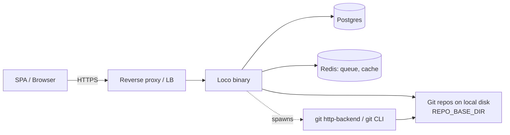
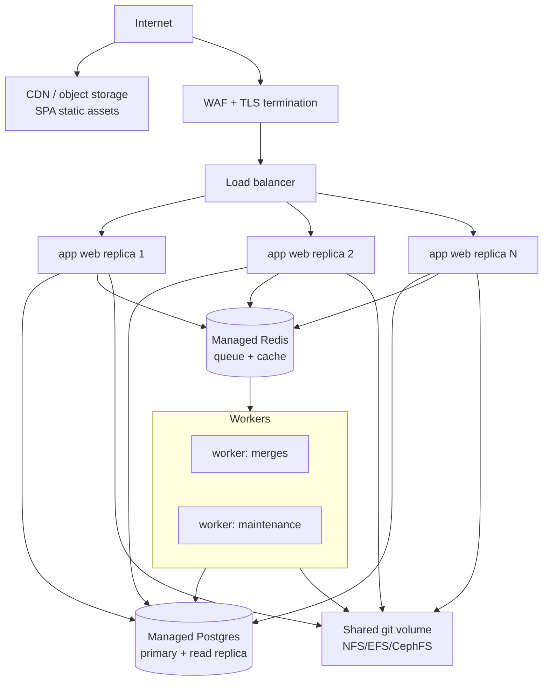

# Deployment and scaling architecture

Status: **design for a later phase**. Nothing in the "target" sections is
implemented. This document records the infrastructure we should run *today*, the
module boundaries we should enforce while the app is still one binary, and the
service split we can migrate to without rewriting the domain.

Related reading: [architecture.md](architecture.md) (two sources of truth,
layers, request flows), [git-transport.md](git-transport.md) (smart HTTP and
push path), [data-model.md](data-model.md) (table ownership).

---

## 1. What we deploy today

One Loco binary does everything, plus a static SPA.



| Component | Current form | Owns |
|---|---|---|
| Loco app | one crate, one process, N replicas possible | all HTTP routes, domain logic, workers, tasks |
| SPA | Vite build served as static files | Redux state, all UI |
| Postgres | one database | users, repos, issues/PRs, social data, events, git caches |
| Redis | Loco queue/cache provider | background jobs (`merge_pull_request`, `downloader`), cache |
| Git storage | local filesystem under `REPO_BASE_DIR` | bare repositories — the authoritative code |

This shape is fine for a single node and for most of Phase 0–4. It hits a wall
because of **stateful git storage**, not because of the Rust code.

### The ceiling

1. **Git storage is node-local.** A second app replica cannot see another
   replica's bare repos. Cloning, browsing and pushing must all land on the same
   node, so horizontal scaling of the web tier is blocked by the filesystem.
2. **`git http-backend` and `git` CLI are spawned per request.** That is CPU and
   I/O work mixed into the web request path; a large clone or diff competes with
   REST traffic.
3. **Workers run in the same binary.** A long merge or a download storm shares
   the web process's resources and failure domain.
4. **One database is a shared coupling point.** Every future service would read
   and write the same tables if we split the binary naively — that is a
   distributed monolith, not microservices.
5. **No explicit integration contract.** We already have the append-only
   `events` table, but producers write to it directly; there is no publisher
   abstraction, no outbox, and no consumer isolation.

---

## 2. Recommended infrastructure (near term — still one binary)

The goal here is to make the current app safe to operate and cheap to scale
vertically/horizontally *before* splitting it.

### Runtime topology



**Containers.** Build two immutable images: `gh-loco-app` (the Loco binary plus
git and CA certificates) and `gh-loco-web` (a tiny Nginx/Caddy serving the Vite
`dist/`). Keep them versioned together by release tag. The SPA image can go on a
CDN; the API stays behind the load balancer.

**Stateless web replicas.** All replicas must be interchangeable. That requires
git storage to be shared (below) and sessions/JWT to be stateless (already true:
JWT + PATs, no server-side session).

**Postgres.** Use a managed service with automated backups, PITR, encryption at
rest, and at least one read replica. Route the browse/cache reads that tolerate
staleness to the replica; keep writes and authorization-sensitive reads on the
primary. The `branches`/`commits` cache tables are already designed to be
rebuildable, so they can live in a separate schema or database later.

**Redis.** Managed Redis with persistence for the queue. Keep the queue and the
cache in separate logical databases (or separate instances) so a cache eviction
storm cannot delay merge jobs. Set job timeouts and dead-letter handling.

**Git storage — the important choice.** Three options, in order of preference
for *this* codebase:

| Option | Pros | Cons | When |
|---|---|---|---|
| Shared POSIX volume (EFS, CephFS, NFS) | No code change; `git http-backend` works as-is; `git clone --bare` still works for forks | Latency on many small files; NFS attribute caching can make refs look stale; single write bottleneck | Now, for up to a modest number of repos and replicas |
| Dedicated git nodes with routing by repo | Scales horizontally; web nodes stay stateless | Requires a routing layer and a copy of the git auth decision | Short term if volume is high |
| Object storage + git service | Elastic, cheap, durable | Git is not object-native; needs a pack/object cache and a service in front | Target architecture (§4) |

Do **not** put a bare repo on object storage and mount it with a FUSE driver and
expect git's ref updates to be safe. That belongs behind a git service.

**Edge.** TLS at the load balancer, HTTP→HTTPS redirect, standard security
headers, rate limits on auth and git endpoints, and request-size limits on
`git-receive-pack`. Serve the SPA through the CDN with hashed asset filenames.

**Observability.** Emit structured logs with a `request_id`, `user_id` and
`repo_id`; export OpenTelemetry traces for REST and for each spawned git
command; expose `/health` (liveness) and a readiness check that verifies Postgres,
Redis and the git mount. Dashboards: push latency, merge job duration/queue
depth, git backend error rate, cache hit ratio, DB connections.

**Secrets and config.** Move the JWT secret, DB URLs and Redis URL out of
checked-in YAML into a secret manager injected at runtime. Keep `REPO_BASE_DIR`
as a mounted path. Never bake secrets into either image.

**CI/CD.** Build and scan images, run `cargo fmt --check`, `cargo clippy
--all-targets -- -D warnings`, `cargo test`, `pnpm test`, `pnpm build`, then roll
web replicas with a readiness gate and keep the previous tag for quick rollback.
Migrations run as a separate, one-shot job — never from multiple replicas at
boot (Loco's boot-time migrate is convenient locally but unsafe at scale; gate
it with a leader-election or disable it in production images).

**Scaling rules.** Scale web replicas on CPU and request latency. Scale workers
on queue depth and merge duration. Alert on git-volume IOPS and on push error
rate — those are the first signals that the shared-volume approach is exhausted.

---

## 3. Modular monolith: boundaries to enforce now

A service split succeeds only if the code is already split. Today the crate has
good physical modules but loose logical ones: controllers import other
contexts' models freely. Before extracting anything, make these boundaries real.

### Bounded contexts mapped to current code

| Context | Owns (tables/modules) | Current entry points |
|---|---|---|
| Identity | `users`, `personal_access_tokens`, JWT/auth flows | `controllers/auth.rs`, `controllers/tokens.rs` |
| Repository metadata | `repositories`, `collaborators`, `branch_protection_rules`, `forks` | `repositories.rs`, `collaborators.rs`, `protection.rs`, `forks.rs` |
| Git transport & browsing | bare repos, `data/git.rs`, `branches`, `commits` | `git_http.rs`, `git_browse.rs` |
| Issues & pull requests | `issues`, `issue_comments`, `labels`, `issue_labels`, `pull_requests`, `review_comments`, `pr_reviews`, merge worker | `issues.rs`, `pulls.rs`, `workers/merge_pull_request.rs` |
| Social & activity | `stars`, `watches`, `events` | `social.rs` |
| Delivery (future) | notifications, webhooks, mailer | none yet |

### Rules to adopt while it is still one crate

1. **Table ownership is explicit.** A context may read another context's tables
   only through that context's public model functions, never by importing
   `_entities` or writing raw SeaORM queries. Add a short `CONTEXT.md` per module
   listing its tables and its public interface.
2. **Cross-context calls go through traits.** Define narrow ports in the caller:
   `GitStore` (resolve ref, read tree, merge), `IdentityLookup` (user by pid/handle),
   `EventPublisher` (append an integration event), `Notifier`. The current
   `GitRepo` struct is already the seed of `GitStore` — turn it into a trait and
   keep one filesystem implementation.
3. **DTOs are the contract.** `src/dtos/*` already derive `ts-rs`; keep them
   framework-free. Future services exchange these shapes over gRPC/JSON, so no
   SeaORM entity or `AppContext` may leak into a DTO or a port signature.
4. **Integration events, not shared writes.** The `events` table is the right
   *concept*, but it is currently written inline by every controller. Put an
   `EventPublisher` behind it and have services publish to a broker/outbox. Keep
   payloads as display hints, as the docs already require — never re-read an
   event to reconstruct authoritative state.
5. **Use the outbox pattern for cross-context side effects.** For example,
   "PR merged" must update the PR row *and* publish an event. Write both in one
   local transaction to an `outbox` table; a relay publishes it. This avoids a
   half-finished side effect when a service boundary appears.
6. **Make commands idempotent.** The merge worker already reloads rows and
   guards `update-ref`. Apply the same rule to every future command: accept an
   idempotency key, tolerate retries, and never assume "exactly once".
7. **No distributed transactions across future services.** Use sagas with
   compensating actions (as repo creation already rolls back its DB row when
   `git init` fails).
8. **Keep authorization in one place.** `repositories::Model::can()` must remain
   the single rule. In the target design it becomes the Repository service's
   `Authorize` API (or a shared policy library), called by the git service and
   the gateway — never reimplemented per service.

### Concrete refactors to schedule

- Extract `GitStore` from `data/git.rs`; inject it instead of constructing
  `GitRepo` in controllers.
- Add `EventPublisher` + an `outbox` table; migrate the inline `events::record`
  calls in issues, pulls, collaborators, social, forks and `git_http` to it.
- Introduce `IdentityLookup` so controllers stop calling
  `users::Entity::find_by_id` for display names.
- Separate worker deployments (merge, maintenance) while keeping the same
  binary and queue — this is a deployment change, not a code split.

---

## 4. Target: services, events, and a service mesh

When git volume, team size or deployment independence justifies it, split along
the contexts above. Keep the SPA and a single public API entry point unchanged.

```mermaid
flowchart TB
    SPA[SPA] --> GW[Edge / API gateway / BFF]
    GW --> MESH{{Service mesh: mTLS, discovery, retries, canaries}}

    MESH --> ID[Identity service<br/>users, PATs, tokens]
    MESH --> REPO[Repository service<br/>repos, roles, protection, forks, can()]
    MESH --> GIT[Git service<br/>smart HTTP, refs, objects]
    MESH --> ISSUE[Issues & PRs service<br/>issues, PRs, reviews, merge commands]
    MESH --> ACT[Activity service<br/>events, notifications, webhooks]
    MESH --> SEARCH[Search service<br/>index]

    ISSUE -.publish.-> BROKER{{Event broker<br/>Kafka / NATS / Redis Streams}}
    REPO -.publish.-> BROKER
    GIT -.publish.-> BROKER
    BROKER -.consume.-> ACT
    BROKER -.consume.-> SEARCH
    BROKER -.consume.-> ISSUE

    ID --- IDDB[(ID DB)]
    REPO --- REPDB[(Repo DB)]
    ISSUE --- ISSUEDB[(Issue DB)]
    ACT --- ACTDB[(Activity DB)]
    GIT --- OBJ[(Object store<br/>+ local pack cache)]
```

### Service responsibilities

| Service | Owns | Talks to |
|---|---|---|
| Identity | users, credentials, PATs, token verification | its DB; publishes `user.registered`, `token.revoked` |
| Repository | repo metadata, collaborators, protection rules, forks, **authorization** | its DB; called by gateway and git service; publishes `repo.created`, `repo.deleted`, `fork.created` |
| Git | clone/fetch/push, ref resolution, diff/compare, merge execution | object store; calls Repository `Authorize` on every request; publishes `push.completed`, `ref.updated` |
| Issues & PRs | issues, labels, PRs, reviews, merge *orchestration* | its DB; calls Git `Merge`; publishes `pr.opened`, `pr.merged`, `pr.approved` |
| Activity | append-only event log, fan-out, email, webhooks | its DB; consumes all domain events |
| Search | code/issue/repo index | its index; consumes events; called by gateway |
| Gateway/BFF | TLS, auth token verification, rate limits, SPA contract aggregation | all services via mesh |

### Events vs messages vs mesh — which is which

These are complementary, not alternatives.

| Mechanism | Use for | Example here | Why |
|---|---|---|---|
| **Synchronous messages** (gRPC/HTTP through the mesh) | Queries and commands that need an immediate answer or a strong decision | gateway → Repository `Authorize`; Issues → Git `Merge`; gateway → repo metadata | The caller needs the result now; mesh gives mTLS, retries, timeouts and circuit breaking |
| **Asynchronous events** (broker, pub/sub) | Cross-service side effects that do not belong in the request path | `pr.merged` → Activity, Search, notifications; `push.completed` → PR head refresh | Decouples producers from consumers; a slow notification service cannot slow a merge |
| **Message queue / work queue** (Redis today, broker later) | Long-running, retryable commands with one consumer | merge jobs, fork copies, repo deletion, index rebuild | Backpressure and at-least-once delivery with idempotent handlers |
| **Service mesh** | Transport concerns between services | all service-to-service calls | mTLS, identity, observability, traffic splitting, canaries — not business logic |

Recommendation: **hybrid**. Keep authorization and merge as synchronous calls
through the mesh; make everything that reacts to a completed fact an event. Do
not try to express `can(user, repo, Write)` as an eventual-consistency event — a
push decision must be authoritative at request time.

### Consistency patterns

- **Database per service.** No shared tables. The Repository service is the only
  writer of `repositories`; the Git service keeps a cache of the authorization
  decision with a short TTL and invalidates on `role.changed`.
- **Outbox + relay** for every event a service publishes with a local state
  change. Consumers must be idempotent; use `(event_id, consumer)` dedupe.
- **Sagas** for multi-service workflows. `fork`: Repository reserves the name →
  Git copies objects → Repository commits the edge; if the copy fails, a
  compensating command releases the name and removes objects.
- **Read models** for the SPA. The gateway can aggregate repo metadata + social
  counts + viewer role into the current `RepoResponse` so the frontend contract
  (and the `ts-rs` bindings) does not change when services split.
- **Webhook delivery** is already a queue + persisted-delivery pattern. Today
  the worker POSTs directly; when split, move it behind a dedicated Delivery
  service with the same `(event_id, webhook)` dedupe and HMAC signing key kept in
  a secret store. Workers need outbound egress and should run in a separate
  pool from request-serving processes so a slow endpoint cannot starve the API.

### Scaling the Git service specifically

- Shard bare repositories by a stable hash of `owner/name`; route via the
  Repository service or a consistent-hash-aware gateway.
- Keep an object-store-backed pack cache on each git node. Hot repos stay local;
  cold repos hydrate on demand.
- Separate read nodes (clone/fetch/browse) from write nodes (push/merge). Ref
  updates need a single writer per repo; use a lease/lock service or serialize
  writes per shard.
- Maintain ref-based caches (`branches`, default-branch `commits`) in a small
  Postgres/Redis per shard, invalidated by `ref.updated` events — the same
  cache-invalidation idea already used in `git_http.rs`.
- Keep `git http-backend` as the protocol implementation. It is correct and
  battle-tested; the service only supplies auth, routing and storage.

---

## 5. Migration path (strangler fig)

Each step must keep the public API and `ts-rs` bindings unchanged, ship behind a
flag, and have a rollback.

| Step | Move | Exit criterion |
|---|---|---|
| 0 | Enforce §3 boundaries in the monolith: ports, table ownership, outbox, idempotent commands | No controller imports another context's `_entities`; all events flow through `EventPublisher` |
| 1 | Split deployment: separate web and worker images/processes | Workers scale independently; queue depth is observable |
| 2 | Extract **Git service** first — the cleanest seam (`GitStore`) | All clone/push/browse traffic goes through it; monolith keeps the same trait point to a network client |
| 3 | Extract **Activity service** and the broker relay | All events are published once and consumed by Activity; the SPA feed is unchanged |
| 4 | Extract **Identity** | Token verification is a mesh call; gateway verifies once and passes identity headers |
| 5 | Extract **Repository metadata** (including `can()`) | Git service authorizes through the Repository API; no direct DB access to repo tables |
| 6 | Extract **Issues & PRs** | Merge orchestration calls Git `Merge`; workers belong to this service |
| 7 | Introduce the mesh and gateway/BFF | mTLS everywhere, canary deploys, single public entry point |

Why this order: git storage is the scaling bottleneck (step 2 buys the most),
activity is a pure consumer (safest extraction, step 3 validates the broker),
and authorization is extracted last because everything depends on it staying
consistent — by then the Repository service exists as a real boundary.

---

## 6. Trade-offs and open questions

- **Shared volume vs git service.** A shared POSIX volume is weeks of work; a
  git service is months. Choose by measured IOPS/latency, not by architecture
  taste. The `GitStore` port makes the change cheap when the time comes.
- **Kafka vs NATS vs Redis Streams.** Kafka for high-volume replay and many
  consumers; NATS for low-latency, simple ops; Redis Streams is the smallest
  step from today's Redis queue. Start with the smallest that satisfies the
  retention/replay requirement.
- **Istio vs Linkerd vs Consul.** Linkerd for a small operational footprint;
  Istio if you need richer traffic policy and already run Kubernetes. The mesh
  is optional until there are several services.
- **gRPC vs REST between services.** gRPC for generated contracts and streaming
  diffs; REST is fine where the existing DTOs already serialize cleanly. Do not
  let the mesh hide a chatty protocol — keep calls coarse.
- **Multi-region.** Not planned. The git single-writer-per-repo rule plus a
  shared Postgres primary make active/active hard. Start with regional read
  replicas for clones; revisit only when latency demands it.
- **Data retention.** The `events` log grows forever. Decide a retention policy
  and an archive tier before it becomes an operational problem.

---

## 7. What to do next

1. Add `CONTEXT.md` files for the six contexts in §3.
2. Introduce the `GitStore` and `EventPublisher` ports with the current
   implementations; migrate inline event writes to the publisher.
3. Split web and worker deployments and add the observability signals in §2.
4. Revisit the service split now that organizations/teams exist: the Repository
   service's `Authorize` contract must accept both user-owned and org-owned
   repositories, with team grants resolved inside that service.
